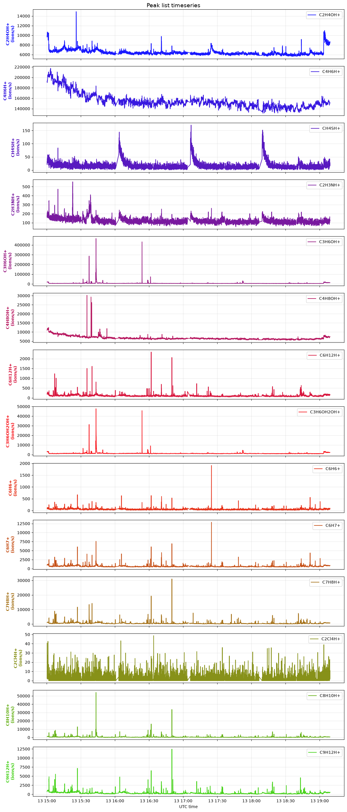

# OpenTof

A Python library for end-to-end processing of Time-of-Flight Mass Spectrometry (ToF-MS) data from Tofwerk instruments (`.h5` files).

## Installation

Install OpenTof and all its dependencies directly via `pip`:

```bash
pip install opentof
```

See our installation guide: [installation](docs/getting-started/installation.md)!

## Getting Started?

- Overview of OpenTof's basic usage: [quickstart](docs/getting-started/quickstart.md)
- A more in-depth overview of the primary `Deployment` class: [deployment](../opentof_repo/docs/)
- Example jupyter notebook for PTR-TOF data: [demo_PTR.ipynb](examples/demo_PTR.ipynb)
- More documentation coming soon!

## OpenTof Automated Features Showcase:

1. Mass calibration
2. Window selection for reference spectrum
3. Baseline determination
4. Peak width
5. Peak shape
6. Full peak fitting and area integration

Example Output:


## Contributing to OpenTof:

- Contributions to OpenTof's source code is encouraged!
- See [contributing](docs/contributing.md) for a description of eventual changes that would benefit the code!