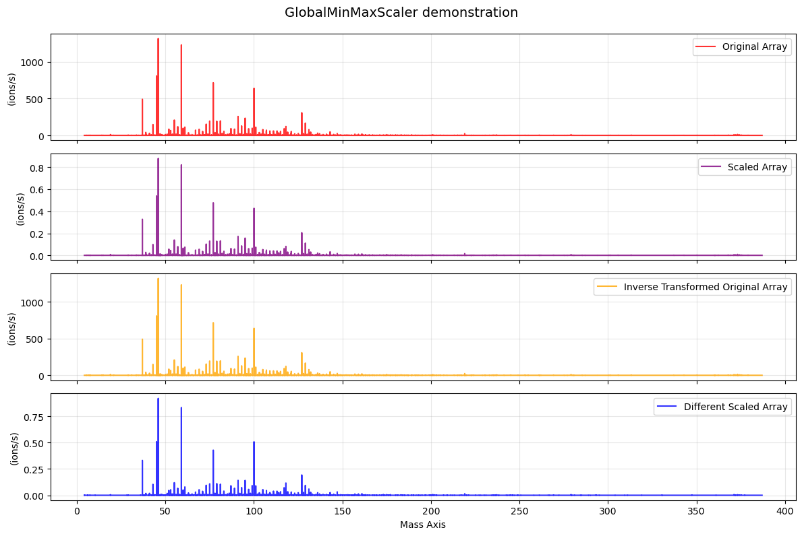
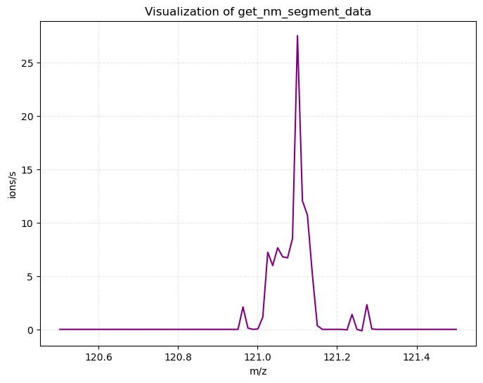

# Overview of `utils.py`

The `utils.py` file is a collection of "utility" functions that aren't necessarily crucial for an individual file (or are broadly used by all files).

It could likely be better organized and currently contains a hodge-podge of functions, but they all have their specific use cases.

This document serves as an overview of these functions. For an automatically generated (LLM) summary of the available parameters in each function please see [api-reference](../api-reference/).


## `return_mass`

Starting at the bottom of the file for this one we have arguably the most widely used "utility" function across other files within OpenTof, and one that anyone who has follow the installation tutorial is already familiar with.

This function simply takes a string chemical formula (that matches an `Element` entry in `class PeriodicTable`) and returns the theoretical mass for that formula.

It can be called with:

```python
ot.return_mass("C3H6OH+")
# output
"""
59.04914126
"""
```

It is important to note that the mass of specific isotopes can also be specified in this function.

For example, if you are working with a bromide CIMS you might define your calibrants for mass calibration as something like:

```python
calibrants = {
    'Br-': ot.return_mass("Br-"),
    '[81]Br-' : ot.return_mass("[81]Br-"),
    'H2OBr-' : ot.return_mass('H2OBr-'),
    'H2O[81]Br-' : ot.return_mass('H2O[81]Br-'),
}
# output
"""
{'Br-': 78.91888618,
 '[81]Br-': 80.91683827,
 'H2OBr-': 96.92945086,
 'H2O[81]Br-': 98.92740296}
"""
```

In this example the bracketed `[81]` in front of the `Br` indicates that we want the bromide isotope closest to nominal mass 81. 

In the same vein we could also define similar isotopes. Here's an example calling all isotopes of Iron (`Fe`).

```python
print(ot.return_mass("Fe"))
print(ot.return_mass("[54]Fe"))
print(ot.return_mass("[57]Fe"))
print(ot.return_mass("[58]Fe"))
```

## `GlobalMinMaxScaler`

This is a simple class that scales an entire numpy array between 0-1 using the global minimum and maximum of the array. It's usage mimics scikit-learn's `MinMaxScaler` but scales the entire array rather than feature-wise (column-wise).

As a quick example we can pretend that we want to scale a certain block of the `Deployment.tofdata` dataset:

```python
# Read in a block of the tofdata Dask array as a numpy array (via compute)
temp_arr = d.tofdata[1000:1100, :].compute()
# shape=(100, 31104)

# Initialize the scaler
scaler = ot.GlobalMinMaxScaler()

# Fit the scaler to the data (compute global min and max)
scaler.fit(temp_arr)

# Call the scaler to scale the array between 0 and 1
scaled_temp_arr = scaler.transform(temp_arr)

# Perform an inverse transformation on the array to retrieve the original result
orig_arr = scaler.inverse_transform(scaled_temp_arr)


# Setup subplots
fig, axes = plt.subplots(
    nrows=4, 
    ncols=1, 
    figsize=(12, 2 * 4), 
    sharex=True
)

# First subplot: Random spectra in original array
axes[0].plot(
    d.first_guess_mass_axis, 
    temp_arr[50, :], 
    label="Original Array", 
    alpha=0.8,
    color='red',
)

axes[0].set_ylabel(f"(ions/s)")
axes[0].grid(True, alpha=0.3)
axes[0].legend(loc="upper right")

# Second subplot: Same array as above but processed though the GlobalMinMaxScaler
axes[1].plot(
    d.first_guess_mass_axis, 
    scaled_temp_arr[50, :], 
    label="Scaled Array", 
    alpha=0.8,
    color='purple',
)

axes[1].set_ylabel(f"(ions/s)")
axes[1].grid(True, alpha=0.3)
axes[1].legend(loc="upper right")

# Third subplot: Same array as above but inversed scaled back to original
axes[2].plot(
    d.first_guess_mass_axis, 
    orig_arr[50, :], 
    label="Inverse Transformed Original Array", 
    alpha=0.8,
    color='orange',
)

axes[2].set_ylabel(f"(ions/s)")
axes[2].grid(True, alpha=0.3)
axes[2].legend(loc="upper right")

# Forth subplot: Show that the scaler was global by visualizing a different spectra
axes[3].plot(
    d.first_guess_mass_axis, 
    scaled_temp_arr[90, :], 
    label="Different Scaled Array", 
    alpha=0.8,
    color='blue',
)

axes[3].set_ylabel(f"(ions/s)")
axes[3].grid(True, alpha=0.3)
axes[3].legend(loc="upper right")

# Set the overall title and bottom x-axis label
fig.suptitle("GlobalMinMaxScaler demonstration", fontsize=14, y=0.99)
axes[-1].set_xlabel("Mass Axis")

plt.tight_layout()
plt.show()
plt.close()
```



## `load_peak_list`

This function can be used to either define a peak list or a calibrant dictionary from a traditional Tofware (.txt) peak list. As an example we can use a peak list created by NOAA's Chemical Science Laboratory during the AEROMMA campaign. This peak list is for PTR chemistry. 

A copy can be found here: https://drive.google.com/file/d/1JWqdC2hqYxpNFuDAt2qVw7B9-cGRnudY/view?usp=sharing

Lets try out this function using this list!

```python
raw_df, peak_list, skipped_peaks = ot.load_peak_list("H3O_peaklist_AEROMMA_20230624.txt")
print(peak_list)
# output
"""
['C+',
 'CH+',
 'N+',
 'CH2+',
 'NH+',
 'CH3+',
 'O+',
 'NH2+',
...

 'C14H18H+',
 'C10H4O4H+',
 'C11H8O3H+',
 'C12H12O2H+',
 'C13H16OH+',
 'C14H20H+',
 'C10H6O4H+',
 ...]
"""
```

This just loads in the formulas in the `'ion'` column of the original peak list (skipping unknown entries) and returns them as a list of string chemical formulas (what is expected by our FFI functions).

Additionally, if it is desirable, its also possible to use this function to directly make a calibrant list for use with `Deployment.mass_calibration` or `mass_calibration.run_mass_calibration`, the keyword for this is `make_calibrant_list=True`.

```python
raw_df, peak_list, skipped_peaks = ot.load_peak_list("H3O_peaklist_AEROMMA_20230624.txt", make_calibrant_list=True)
# output
"""
{'C+': 11.99945142,
 'CH+': 13.00727645,
 'N+': 14.00252542,
 'CH2+': 14.01510148,
 'NH+': 15.01035045,
 'CH3+': 15.02292651,
 'O+': 15.99436603,
 'NH2+': 16.01817548,
...
 'C14H18H+': 187.14812703,
 'C10H4O4H+': 189.01823505,
 'C11H8O3H+': 189.05462056,
 'C12H12O2H+': 189.09100607,
 'C13H16OH+': 189.12739158,
 'C14H20H+': 189.16377709,
 'C10H6O4H+': 191.03388512,
 ...}
"""
```

In this function, the variable `raw_df` is a `pandas.Dataframe` of the original .txt file (read as a tab separated csv) and `skipped_peaks` is a variable that holds a Python list of the string formulas that couldn't be parsed (for strange characters and such).

## `get_nm_segment_data`

This function is more of a convenience method that can be used to extract a specific nominal mass segment of data from an aligned 1D `spectra`, `mass_axis`, and `tof_axis`.

An example to call this function:

```python
random_spectra = d.tofdata[4654, :].compute()
print(random_spectra)
print(d.first_guess_mass_axis)
print(d.tof_axis)

int_segment, mz_segment, tof_segment = ot.get_nm_segment_data(121,
                                                              spectra=random_spectra,
                                                              mass_axis=d.first_guess_mass_axis,
                                                              tof_axis=d.tof_axis)
plt.figure(figsize=(8,6))
plt.plot(mz_segment, int_segment, color="purple")
plt.title("Visualization of get_nm_segment_data")
plt.xlabel("m/z")
plt.ylabel("ions/s")
plt.grid(True, alpha=0.3, linestyle="--")
plt.show()
# output
"""
[0. 0. 0. ... 0. 0. 0.]
[  4.2303524    4.23268244   4.23501312 ... 386.94277011 386.96505165
 386.98733383]
[   99.99999717   100.99999714   101.99999712 ... 31200.99911758
 31201.99911755 31202.99911752]
"""
```


## `spectra_nm_split`